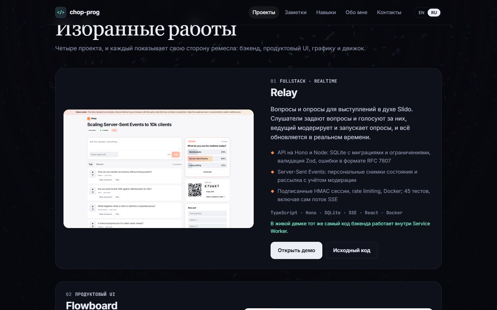

# chop-prog: portfolio

**[chop-prog.github.io](https://chop-prog.github.io)**: the portfolio of a frontend developer, in English and Russian.



## Projects featured

| | Project | Stack |
|---|---|---|
| 01 | [**Relay**](https://github.com/chop-prog/relay): live Q&A and polls with a realtime backend | TypeScript · Hono · SQLite · SSE · React |
| 02 | [**Tandem**](https://github.com/chop-prog/tandem): serverless collaborative whiteboard on a hand-written CRDT | TypeScript · Canvas 2D · BroadcastChannel |
| 03 | [**Cite**](https://github.com/chop-prog/cite): document Q&A where every claim cites its source | React · Anthropic SDK · Claude API |
| 04 | [**Seismic**](https://github.com/chop-prog/seismic): crossfilter dashboard of live USGS earthquakes | TypeScript · Web Workers · Canvas 2D |
| 05 | [**Flowboard**](https://github.com/chop-prog/flowboard): keyboard-first kanban app | React 19 · TypeScript · dnd-kit · Vitest |
| 06 | [**Facet UI**](https://github.com/chop-prog/facet): accessible React components with OKLCH theming | React · TypeScript · axe-core |
| 07 | [**Aurora**](https://github.com/chop-prog/aurora): real-time GPU fluid simulation | WebGL2 · GLSL |
| 08 | [**VOID PULSE**](https://github.com/chop-prog/void-pulse): twin-stick roguelite with a custom engine and online co-op | Canvas 2D · WebRTC · Web Audio · PWA |

## Lab

Small visual experiments, each a single HTML file with no libraries, served from [`lab/`](lab):

| Demo | What it is |
|---|---|
| [Mandelbulb](https://chop-prog.github.io/lab/mandelbulb/) | 3D fractal ray-marched in a WebGL fragment shader, with resolution that adapts to the GPU |
| [Crystal](https://chop-prog.github.io/lab/crystal/) | the five Platonic solids in 3D on Canvas 2D: hand-written projection, depth sorting and lighting |
| [Mountains](https://chop-prog.github.io/lab/mountains/) | procedural layered landscape that runs from dawn to night under the cursor |
| [Live wallpaper](https://chop-prog.github.io/lab/wallpaper/) | four colour moods blended by the cursor, parallax stars and click ripples |

[`lab/lab.js`](lab/lab.js) gives them the portfolio's language choice (EN/RU) and a link back.

## About this site

- Plain HTML, CSS and ES modules, with no framework and no build step.
- **Bilingual (EN/RU).** The HTML ships in English so it works without JavaScript and is easy for crawlers to read. The language is picked from the browser, can be switched, and the choice is remembered. A test checks that both dictionaries stay in sync with the markup.
- **Particle playground.** Type anything and ~16,000 particles assemble into it. The text is rasterised to an offscreen canvas and sampled into targets; each particle is a damped spring with a pointer force field and click shockwaves ([`src/swarm.js`](src/swarm.js), pure and unit-tested). WebGL2 draws the whole swarm in one call with additive blending and motion trails, with a Canvas 2D fallback. The loop runs only while the panel is visible; under `prefers-reduced-motion` the shape is drawn once, without animation.
- **Animated flow-field background.** It is rendered at half resolution, pauses when the tab is hidden, and is static under `prefers-reduced-motion`.
- **Progressive enhancement.** The reveal animations hide content only once JavaScript is running.
- **Accessibility:** a skip link, visible focus states, `aria-pressed` on the language toggle, and semantic sections.
- **Deployment:** GitHub Actions runs the tests and deploys to Pages.

```bash
npm start   # http://localhost:5173
npm test
```

## License

[MIT](LICENSE)
